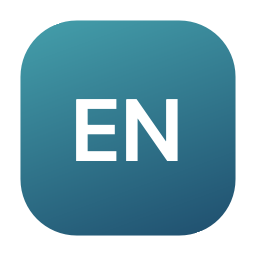
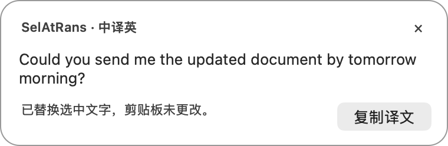
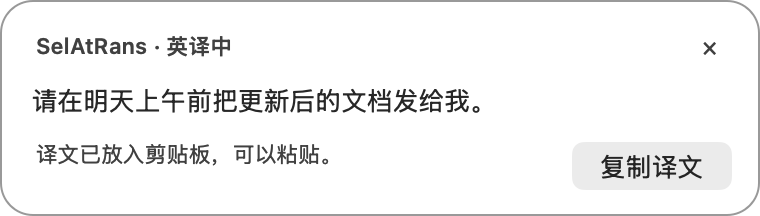

<div align="center">
  
  <h1>SelAtRans</h1>
  <p><strong>选中即译，接着写。</strong></p>
  <p>一个快捷键，把文字变成自然的英文或中文。<br>原生 macOS 小工具，支持原位替换与悬浮流式预览。</p>
  <p>
    <a href="https://github.com/SuooL/SelAtRans/releases/latest"></a>
    
    
    <a href="https://github.com/SuooL/SelAtRans/actions/workflows/ci.yml?query=branch%3Adev"></a>
  </p>
  <p><strong><a href="README.md">English</a> · 简体中文</strong></p>
  <p><a href="https://github.com/SuooL/SelAtRans/releases/latest/download/SelAtRans.dmg"><strong>下载 macOS 版</strong></a> · <a href="#快速开始">快速开始</a> · <a href="CHANGELOG.md">版本记录</a> · <a href="https://github.com/SuooL/SelAtRans/issues">反馈建议</a></p>
</div>

## 在你写字的地方翻译

用英文发消息、用中文阅读资料，或处理刚复制的一段文字。选中后按
**⇧⌘E** 翻成英文，按 **⇧⌘C** 翻成简体中文。SelAtRans 调用你自己的大模型
API，以自然流畅、接近真人的表达为目标，并要求保留原意、结构、术语和代码。

| 中译英 · ⇧⌘E | 英译中 · ⇧⌘C |
| --- | --- |
| <picture><source media="(prefers-color-scheme: dark)" srcset="docs/assets/preview-english-dark.png"></picture> | <picture><source media="(prefers-color-scheme: dark)" srcset="docs/assets/preview-chinese-dark.png"></picture> |

*上图为原生预览组件的离屏渲染，使用虚构演示文本，并非真实 API 翻译过程录屏。
当前设置与状态界面为简体中文。*

- **输入框内直接替换。** 在支持的编辑区域，只替换选中的文字，剪贴板保持原样。
- **译文边生成边显示。** 两个方向都支持流式预览；浮窗跟随 icon 移动，短文紧凑，长文滚动。
- **你继续操作，原文受到保护。** 等待时切换窗口、移动光标或修改文字，会保留输入框原文，将译文放到剪贴板并提示。
- **模型由你选择。** 多个 OpenAI 兼容 Chat Completions 配置可增删改查、测试和切换启用，分别设置模型、密钥和 effort；初始配置为 DeepSeek。
- **桌面少一点打扰。** 一个可拖动的状态浮标，不占菜单栏或 Dock，不监听剪贴板，也不保存翻译历史。

## 快速开始

**需要 macOS 13+，以及你自己的兼容 API 访问权限。** 同一个安装包支持
Apple Silicon 和 Intel。翻译需要联网，API 用量与费用按你的服务商账户计费。

1. [下载最新版 DMG](https://github.com/SuooL/SelAtRans/releases/latest/download/SelAtRans.dmg)，
   将 **SelAtRans** 拖到 **应用程序**，然后打开。
2. 在 **翻译配置** 中添加或选择一项，填写 HTTPS API 地址、模型 ID 和 API Key，点击 **保存并启用**。
3. 在 **快捷键与更新** 中前往系统设置，为已安装的应用授予 **辅助功能** 权限，用于读取选区与安全替换。
4. 选中文字，按 **⇧⌘E** 或 **⇧⌘C**。两个快捷键都可以在设置中修改。

当前发布版使用固定的 Apple Development 身份签名，尚未配置 Developer ID 签名及
Apple 公证。请下载正式 Release 附件；CI 构建产物仅用于暂存验证。

### 配置你的 API

LLM 配置以列表展示，可添加、重命名、编辑、测试、删除，并明确启用其中一项。
同一服务商也可以保存多个配置，分别使用不同的模型、密钥或 effort。请求只使用当前启用项。

| 配置项 | 填写方式 |
| --- | --- |
| API 地址 | 服务商提供的 HTTPS 基础地址；需要 `/v1` 时请一并填写。应用会补充 `/chat/completions`，已包含时不重复添加。 |
| 模型 | 你的 API 账户实际可用的模型 ID。 |
| Effort | 建议先用 **服务默认**，此时不发送 `reasoning_effort`；其他等级取决于服务商和模型是否支持。 |
| API Key | 在设置窗口填写，按配置和服务地址来源分别保存。 |

**测试连接** 仅发送固定测试问候语，不会保存或启用配置。确认后点击 **保存并启用**。

## 日常操作

| 操作 | 效果 |
| --- | --- |
| **⇧⌘E** / **⇧⌘C** | 翻译成英文 / 简体中文。 |
| 左键点击浮标 | 展开或收起译文与状态，不抢焦点，不触发翻译。 |
| 拖动浮标 | 浮标与展开的预览窗口一起移动。 |
| 右键点击浮标 | 打开设置、明确翻译剪贴板内容、暂停/恢复快捷键，或退出。 |
| 再次打开应用 | 重新显示设置窗口。 |

| 文字来源或当前情况 | 译文去向 |
| --- | --- |
| 可安全替换的输入框选区 | 只替换选中文字，剪贴板不变。 |
| 只读区域的选中文字 | 放到剪贴板，方便粘贴。 |
| 应用已确认没有选中文字 | 翻译剪贴板文字，并更新剪贴板。 |
| 等待时窗口、光标、选区或输入框内容改变 | 输入框保持原样，译文复制到剪贴板，并提示原因。 |
| 无法确认当前选区，或翻译请求失败 | 显示提示后停止，不擅自使用旧剪贴板，也不写入半截译文。 |

流式内容只用于预览，收到完整且通过校验的响应后才写回输入框或剪贴板。
完成后也可以点击预览中的 **复制译文**。

## 隐私与资源占用

仅在触发翻译或测试连接时，将文字发送到你配置的 HTTPS 服务商，其数据保留政策适用于请求。
应用不在后台监控剪贴板，不保存翻译历史，仅在内存中保留最近一次预览。
空闲时没有翻译轮询或动画，流式界面更新会合并处理。详见[资源设计与测量边界](docs/PERFORMANCE.md)。

API Key 存在本机 **明文私有文件** 中，不使用钥匙串，位置为
`~/Library/Application Support/SelAtRans/Credentials`。目录权限 `0700`、文件权限
`0600`；这是访问权限限制，**并非加密**，以同一用户身份运行的其他进程仍可读取。
密钥按配置和服务地址来源隔离，不进入 Git。详见[安全说明](SECURITY.md)。

## 常见问题

**为什么选中文字后没有直接替换，而是放进了剪贴板？**

不同应用对辅助功能的支持不同。只有确认可编辑目标且内容未变化时才原位替换；
否则会复制完整译文，并显示回退原因。

**为什么无法读取当前选中文字？**

先确认已为当前安装的应用开启辅助功能权限。如果编辑器既不提供选区，也没有可用的复制动作，
请手动复制，再从浮标右键菜单选择 **翻译剪贴板为英文/中文**。
无法确认选区时，不会悄悄翻译上次复制的内容。

**找不到应用入口了？**

桌面浮标就是常驻入口，没有菜单栏或 Dock 图标。再次打开应用可显示设置，右键浮标可退出或暂停快捷键。

**如何更新？**

在 **快捷键与更新 → 检查更新…** 中操作。Sparkle 会验证 GitHub Releases 上的签名更新，
安装前由你确认；每天一次的自动检查可关闭。[查看全部版本与下载](https://github.com/SuooL/SelAtRans/releases)。

**从 v0.1.1 升级后需要重新填写密钥吗？**

需要，每个配置一次。v0.1.2 起 API 密钥改存本机私有文件，不再访问或删除旧版钥匙串条目。

## 构建与参与开发

需要 macOS Command Line Tools、Python 3，以及用于获取固定版本 Sparkle 和 Gitleaks
的网络连接。编译不强制要求完整 Xcode；本机打包需要固定签名身份，支持免费 Xcode
Personal Team 的 Apple Development 身份。

```sh
git clone https://github.com/SuooL/SelAtRans.git
cd SelAtRans
git config core.hooksPath .githooks
scripts/ci-test.sh
open build/package/SelAtRans.app
```

开发流程为 feature/fix/chore 分支 → PR → **dev** → 发版 PR → **main**，
由必需 CI 检查与自动合并把关。提交和创建 PR 前均须通过完整本地 gate。
CI 使用虚构文本和假密钥，不代替真实服务商及跨应用桌面交互验证。

- [需求与验收检查](docs/REQUIREMENTS.md)
- [开发流程与 Agent 署名](docs/DEVELOPMENT.md)
- [版本与签名发布](docs/RELEASING.md)
- [报告问题或提出建议](https://github.com/SuooL/SelAtRans/issues)

如果它让你的工作流更顺畅，欢迎 Star，或分享[下载页面](https://github.com/SuooL/SelAtRans/releases/latest)。
公开反馈请勿包含密钥或私人原文。
